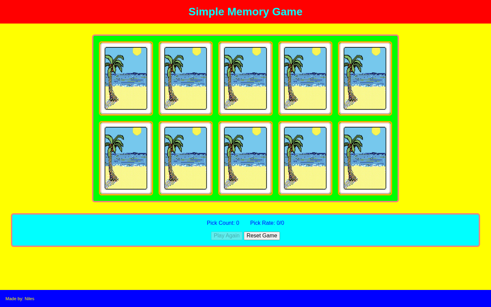

# Simple Memory Game

Match five pairs of shuffled cards while the game tracks picks and results.

## Overview

Simple Memory Game challenges players to find five matching pairs among ten shuffled cards.

Players reveal two cards at a time. Matching cards remain visible, while unmatched cards are turned back over after a short delay. The game tracks card selections and match results as the player works through the deck.

## Features

- Randomized card placement at the start of a game
- Two-card matching logic
- Matched-card state tracking
- Automatic hiding of unmatched cards
- Pick-count tracking
- Match-result tracking
- Game-completion detection
- Controls to continue playing or reset the game
- Responsive card layout

## Technologies

<p>
  <a href="https://developer.mozilla.org/en-US/docs/Web/HTML" title="HTML">
    
  </a>
  &nbsp;
  <a href="https://developer.mozilla.org/en-US/docs/Web/CSS" title="CSS">
    
  </a>
  &nbsp;
  <a href="https://developer.mozilla.org/en-US/docs/Web/JavaScript" title="JavaScript">
    
  </a>
</p>

## How to Run

1. Clone the repository:

```bash
git clone https://github.com/nilesleesmith/simple-memory-game.git
```

2. Open the project folder.

3. Open `index.html` in a web browser.

No additional dependencies or build steps are required.

## Live Site

https://nilesleesmith.github.io/simple-memory-game/

## Screenshots

